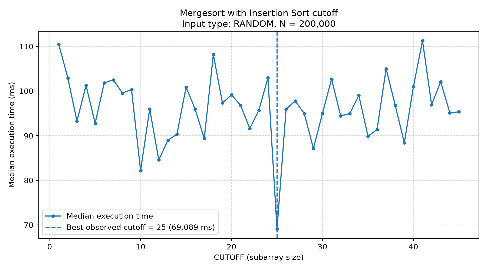
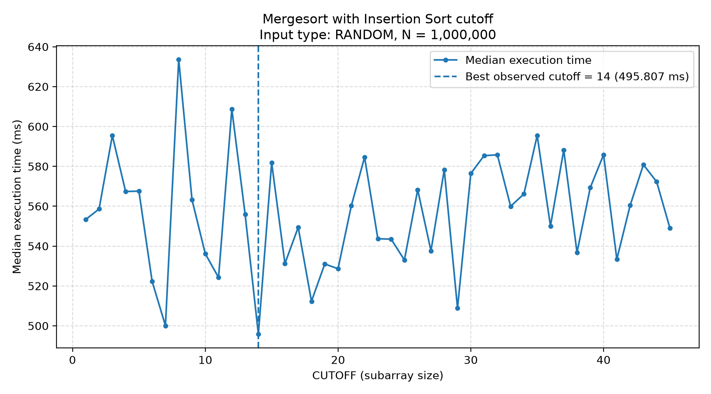
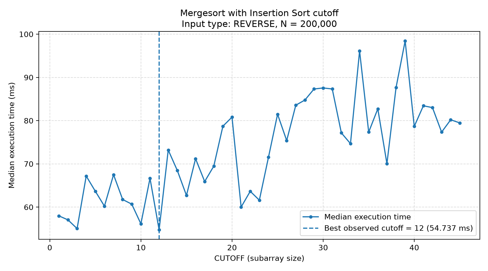
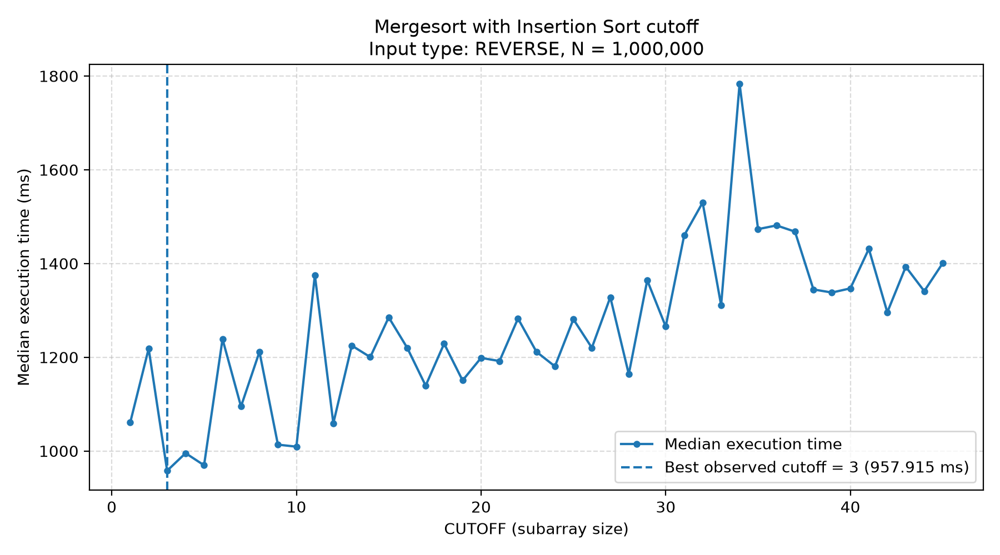
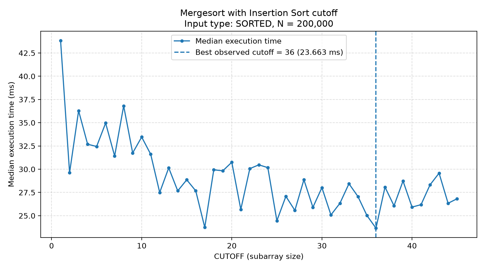
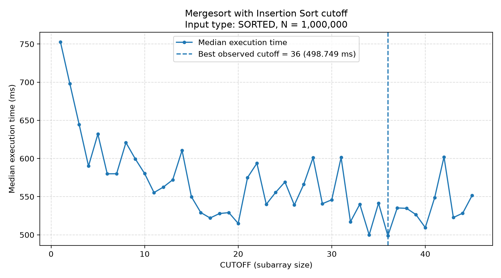

# Mergesort with Insertion Sort Cutoff — Báo cáo thực nghiệm

## 1. Mục tiêu

Project khảo sát giá trị **CUTOFF** phù hợp khi kết hợp Mergesort với Insertion Sort trên máy tính cá nhân.
Trong Mergesort, khi kích thước một subarray <= CUTOFF, thuật toán dừng đệ quy và dùng Insertion Sort để sắp xếp subarray đó. Giá trị CUTOFF quá nhỏ có thể làm tăng số lần chia và merge; giá trị quá lớn khiến Insertion Sort phải xử lý các đoạn dài hơn. Vì vậy, project đo thời gian chạy với nhiều CUTOFF để tìm vùng giá trị phù hợp.

## 2. Cơ sở phương pháp từ bài giảng

Tham khảo chủ đề **1.4 Analysis of Algorithms** của Robert Sedgewick và Kevin Wayne:

- **Scientific method :** đặt giả thuyết, quan sát, dự đoán, kiểm chứng bằng các lần quan sát tiếp theo; thí nghiệm cần có khả năng tái lập.
- **Measuring running time :** đo thời gian tự động bằng đồng hồ; chỉ đặt phần chương trình cần khảo sát trong khoảng bắt đầu–kết thúc đo.
- **Empirical analysis :** chạy chương trình trên các kích thước input khác nhau và ghi nhận running time.
- **Data analysis :** biểu diễn số liệu bằng đồ thị để quan sát xu hướng.
- **Experimental algorithmics :** kết quả phụ thuộc các yếu tố của thuật toán/input/ phần cứng, phần mềm và trạng thái hệ thống như CPU, bộ nhớ, compiler/JVM, garbage collector, hệ điều hành và ứng dụng chạy nền.

Project này dùng `System.nanoTime()` để đo một đoạn chương trình cụ thể, lặp lại nhiều lần với dữ liệu có seed xác định, lấy Median và vẽ đồ thị Median time theo CUTOFF.

## 3. Môi trường thực nghiệm

| Thành phần | Thông tin |
|---|---|
| Hệ điều hành | Windows (chạy từ PowerShell/IntelliJ) |
| IDE | IntelliJ IDEA 2025.3.3 |
| Java | JDK 25.0.2 |
| Python | Python 3 (pandas>=2.0; matplotlib>=3.7) |
| CPU | 11th Gen Intel Core i5-11320H @ 3.20 GHz |
| RAM | 16 GB |

## 4. Cấu trúc project

```text
DSA-Mergesort-Cutoff/
├── MergeCutoff.java
├── CutoffTest.java
├── MergeCutoffTest.java
├── result.py
├── cutoff_measurements.csv
├── cutoff_summary.csv
├── cutoff_best_by_case.csv
├── cutoff_recommendations.csv
├── charts/
│   └── (6 biểu đồ kết quả)
├── README.md
└── .gitignore
```

| File | Chức năng |
|---|---|
| `MergeCutoff.java` | Cài đặt Mergesort kết hợp Insertion Sort theo CUTOFF. |
| `CutoffTest.java` | Tạo dữ liệu, chạy thí nghiệm và đo thời gian. |
| `MergeCutoffTest.java` | Kiểm tra tính đúng đắn của thuật toán. |
| `result.py` | Thống kê dữ liệu, tìm CUTOFF tốt nhất và vẽ biểu đồ. |
| `cutoff_measurements.csv` | Dữ liệu thời gian của từng lần chạy. |
| `cutoff_summary.csv` | Các thống kê Median, Mean, Min, Max và độ lệch chuẩn. |
| `cutoff_best_by_case.csv` | CUTOFF tốt nhất theo từng trường hợp. |
| `cutoff_recommendations.csv` | So sánh và đề xuất CUTOFF chung. |
| `charts/` | Lưu 6 biểu đồ kết quả thực nghiệm. |
| `README.md` | Mô tả quá trình và kết quả thực nghiệm.

## 5. Thiết kế thí nghiệm

| Yếu tố | Giá trị |
|---|---|
| CUTOFF | Từ 1 đến 45 |
| Kích thước mảng (N) | 200.000 và 1.000.000 |
| Dạng input | RANDOM, SORTED, REVERSE |
| Số lần đo cho mỗi cấu hình | 15 |
| Warm-up | 2 lượt cho mỗi CUTOFF, trên mảng 10.000 phần tử |

### Tạo input

- **RANDOM:** tạo mảng `Integer[]` bằng `java.util.Random` với seed được xác định trước.
- **SORTED:** tạo dữ liệu rồi sắp xếp tăng dần bằng `Arrays.sort()`.
- **REVERSE:** tạo dữ liệu, sắp xếp tăng dần rồi đảo ngược mảng.

Trong cùng một vòng và cùng một cấu hình input, mọi CUTOFF đều nhận cùng mảng gốc để so sánh trên cùng dữ liệu.

## 6. Đo running time trên máy

Thực hiện trong `CutoffTest.java` theo trình tự:

1. **Warm-up JVM:** trước khi lấy số liệu chính thức, chương trình chạy thử từng CUTOFF trên input nhỏ. 
2. **Tạo input gốc:** với mỗi cặp dạng input và N, chương trình sinh một mảng gốc bằng seed xác định.
3. **Lặp 15 vòng:** ở mỗi vòng, thứ tự thử 45 giá trị CUTOFF được xáo trộn để tránh luôn đo một CUTOFF ở cùng vị trí.
4. **Chuẩn bị bản sao:** trước mỗi phép đo, chương trình clone mảng gốc. Thời gian tạo dữ liệu và clone không nằm trong khoảng đo.
5. **Bấm giờ:** gọi `System.nanoTime()` ngay trước và sau `MergeCutoff.sort(working, cutoff)`.
6. **Kiểm tra kết quả:** sau khi dừng đồng hồ, gọi `MergeCutoff.isSorted()` để xác nhận mảng đã tăng dần. Thời gian kiểm tra không được cộng vào running time.
7. **Lưu dữ liệu thô:** ghi thời gian từng lần chạy vào `cutoff_measurements.csv`.


Đoạn lệnh được bấm giờ là:

```java
long start = System.nanoTime();
MergeCutoff.sort(working, cutoff);
long end = System.nanoTime();

double elapsedMs = (end - start) / 1_000_000.0;
```

**Phạm vi của phép đo:** thời gian bao gồm toàn bộ lời gọi `MergeCutoff.sort()`, trong đó có cấp phát mảng phụ `aux` bên trong hàm `sort` public, các lời gọi đệ quy, Insertion Sort và các thao tác merge. Phép đo không bao gồm sinh input, clone input, kiểm tra `isSorted`, ghi CSV.

## 7. Xử lý và trực quan hóa dữ liệu

File `result.py` dùng pandas để đọc dữ liệu thô, nhóm theo `InputType`, `N` và `Cutoff`, sau đó tính:

- **MedianMs:** trung vị của 15 lần chạy; 
- **MeanMs:** thời gian trung bình.
- **StdMs:** độ lệch chuẩn mẫu.
- **MinMs / MaxMs:** thời gian nhỏ nhất và lớn nhất.
- **Repetitions:** số lần đo trong nhóm.

Đồ thị: trục X - CUTOFF, trục Y - Median execution time (ms). Đường thẳng đứng đánh dấu CUTOFF có Median thấp nhất trong phạm vi 1–45.

Để so sánh một CUTOFF chung qua sáu trường hợp mà không để trường hợp có thời gian tuyệt đối lớn chi phối, script còn tính thời gian tương đối:

\[
RelativeTime =
\frac{MedianMs\ \text{của CUTOFF đang xét}}
{MedianMs\ \text{nhỏ nhất trong cùng trường hợp}}
\]

Sau đó lấy trung bình RelativeTime qua sáu trường hợp. Giá trị càng gần 1 càng tốt. Đây là tiêu chí tổng hợp do project lựa chọn, không thay thế việc xem từng đồ thị riêng.

## 8. Kết quả thực nghiệm

### 8.1. CUTOFF tốt nhất theo từng trường hợp

Các số dưới đây lấy từ `cutoff_best_by_case.csv`. 

| Dạng input | N | CUTOFF tốt nhất quan sát được | Median (ms) |
|---|---:|---:|---:|
| RANDOM | 200.000 | 25 | 69.089 |
| RANDOM | 1.000.000 | 14 | 495.807 |
| REVERSE | 200.000 | 12 | 54.738 |
| REVERSE | 1.000.000 | 3 | 957.915 |
| SORTED | 200.000 | 36 | 23.663 |
| SORTED | 1.000.000 | 36 | 498.749 |

Không có một CUTOFF duy nhất đứng đầu trong cả sáu trường hợp. Kết quả tốt nhất thay đổi theo dạng input và kích thước N.

### 8.2. So sánh một CUTOFF chung

Theo tiêu chí MeanRelativeTime của `cutoff_recommendations.csv`:

| CUTOFF | MeanRelativeTime | Nhận xét |
|---:|---:|---|
| 17 | 1.140868 | Xếp hạng tổng hợp cao nhất |
| 12 | 1.141177 | Gần như ngang với 17 |
| 10 | 1.154521 | Mốc tham khảo mới |
| 7 | 1.226445 | Mốc tham khảo cũ |

CUTOFF 17 và 12 gần như ngang nhau: chênh lệch MeanRelativeTime khoảng 0,000309 (xấp xỉ 0,027%). Nếu cần chọn một giá trị chung, có thể chọn 12 hoặc 17. 

### 8.3. Đồ thị kết quả

Mỗi đồ thị biểu diễn Median execution time theo CUTOFF; đường nét đứt đánh dấu điểm có Median thấp nhất trong miền đã thử.

**RANDOM**





**REVERSE**





**SORTED**





## 9. Nhận xét và giới hạn của kết quả

1. **Kết quả phụ thuộc input.** SORTED có CUTOFF tốt nhất quan sát được là 36 ở cả hai kích thước; REVERSE có CUTOFF tốt nhất là 12 và 3; RANDOM có kết quả 25 và 14. => Phân phối/thứ tự ban đầu của dữ liệu ảnh hưởng đến thời gian.
2. **Không kết luận tối ưu ngoài miền khảo sát.** Vì chỉ thử CUTOFF từ 1 đến 45, kết quả chỉ xác định giá trị tốt nhất trong miền này. Nếu điểm tốt nhất nằm sát biên, cần mở rộng miền.
3. **Có nhiễu trong quá trình đo.** Do việc chạy các luồng trên máy tính.

## 10. Kết luận

Trong thực nghiệm này, CUTOFF tốt nhất quan sát được không đồng nhất giữa RANDOM, SORTED và REVERSE, không đồng nhất giữa N = 200.000 và N = 1.000.000. Mốc 7 hoặc 10 khá gần giá trị tốt nhất ở một số trường hợp, nhưng không phải tốt nhất ở mọi  trường hợp.

Nếu cần một CUTOFF chung theo tiêu chí tổng hợp hiện tại, 12 và 17 là hai giá trị gần như ngang nhau. Chưa thể khẳng định một giá trị tối ưu tuyệt đối vì số đo có nhiễu và miền khảo sát giới hạn ở 1–45.

Kết luận: **CUTOFF tối ưu là kết quả thực nghiệm phụ thuộc cấu hình máy, cách cài đặt và dữ liệu đầu vào; các giá trị 7 và 10 là mốc tham khảo, không phải hằng số dùng cho mọi môi trường.**

## 11. Cách thực hiện thí nghiệm

1. **Chạy `MergeCutoffTest.java`** để kiểm tra tính đúng đắn của thuật toán.
2. **Chạy `CutoffTest.java`** để thực hiện thí nghiệm và đo thời gian. Kết quả thô được lưu vào `cutoff_measurements.csv`.
3. **Chạy `result.py`** để thống kê dữ liệu và tạo biểu đồ trong thư mục `charts/`.

**Đọc kết quả:**
- `cutoff_best_by_case.csv`: CUTOFF tốt nhất theo từng loại dữ liệu và kích thước mảng.
- `cutoff_recommendations.csv`: So sánh và đề xuất CUTOFF chung.
- `cutoff_summary.csv`: Các số liệu thống kê chi tiết.
- `charts/`: Sáu biểu đồ trực quan hóa kết quả thực nghiệm.
